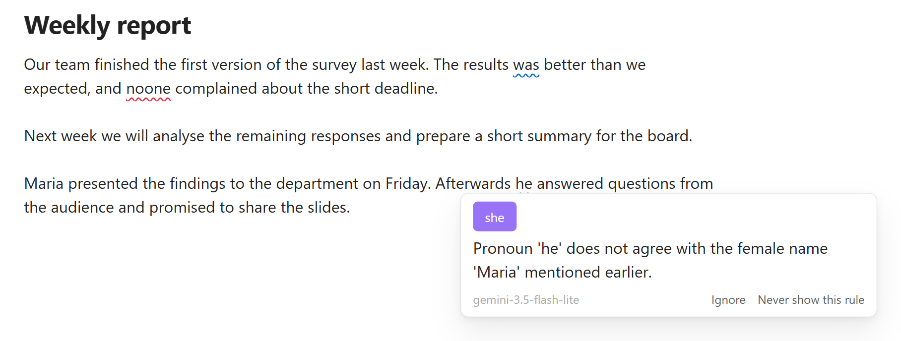
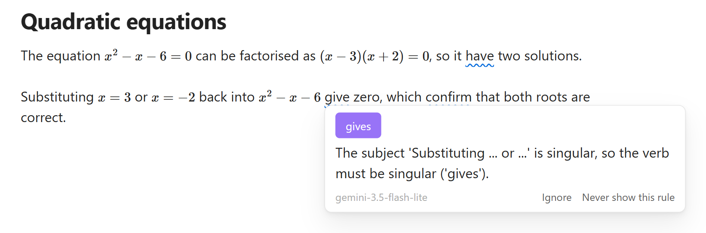
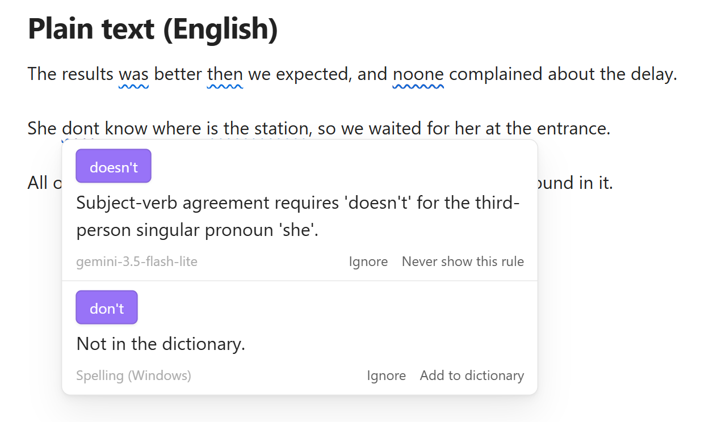
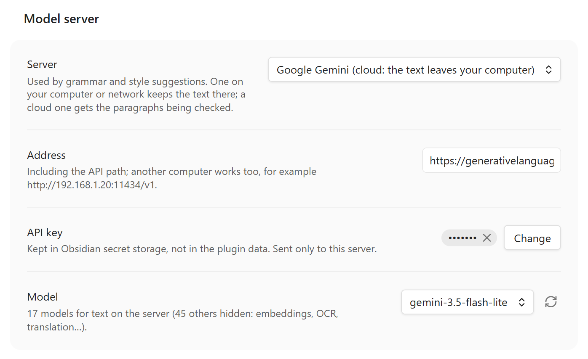
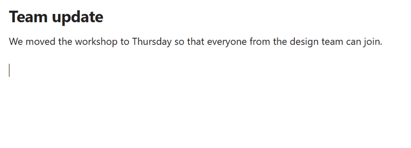
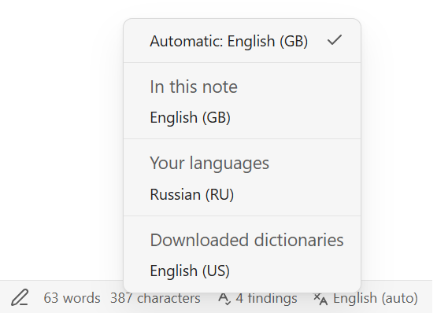

# BlueProof

Spelling and grammar checking for Obsidian by a language model that reads the whole sentence: it catches the errors
rule-based checkers miss, leaves your LaTeX formulas alone, and checks each paragraph in its own language. The model
runs on your own computer or in the cloud (OpenAI, Anthropic, Google Gemini, DeepSeek). On computers, phones and tablets.



## Features

- **Reads for meaning.** The model checks each sentence against the ones before it: "Maria presented the findings.
  Afterwards he answered questions." On our test sentences models found far more errors than LanguageTool ([what we found](docs/comparison.md)).
- **Math stays out of the way.** A formula in the middle of a sentence confuses most checkers. BlueProof keeps
  formulas out of the check, never changes them, and still checks the sentence around them.
- **Many languages**, a different one in each paragraph.
- **Underlines as you write**: red for spelling, blue for grammar. Click one for the fixes; nothing in your note changes
  until you pick one.
- **Never slows your typing**: checks run after a pause, only on what changed. Long paragraphs are cut at sentence ends,
  each piece with the sentence before it for context: as many errors found, two to four times sooner.
- **Few false alarms.** A fix that rewrites the sentence, translates a word or changes a number is thrown away.
- **Spelling** with Windows' own checker or Hunspell dictionaries, plus your own word lists kept as notes.
- **Style suggestions** on a command.



A spelling checker sees one word; the model reads the sentence. Here the dictionary offers *don't*, and the model,
seeing *She*, gives *doesn't* and says why:



## Installation

In Obsidian: **Settings → Community plugins → Browse**, search for **BlueProof**, install it and turn it on. Updates come
through **Check for updates** there, though a new release may take a while to show.

Or by hand: download `main.js`, `manifest.json` and `styles.css` from the [latest release](../../releases/latest), put them
into `<your vault>/.obsidian/plugins/blueproof/`, and turn on **BlueProof** under **Settings → Community plugins**.

## Setup

### Spelling

**Windows**: works at once, with Windows' own spell checker, in the languages installed in Windows. A note in American
English needs English (United States) there, not only English (United Kingdom); **Settings → BlueProof → Spelling**
lists the ones Windows has.

**Linux and macOS**: download a dictionary for your language in **Settings → BlueProof → Spelling → Manage…** (the
system's Hunspell dictionaries count too). Not tested on macOS yet.

**Android and iOS**: download a dictionary the same way, or leave spelling to your phone's keyboard: choose **Off** under
**Spelling → Checked by**. Tested on Android; not on iOS yet.

A language with no dictionary gets ⚠ in the status bar (on a phone, which has none, a notice says so).

While BlueProof checks spelling, Obsidian's own spellcheck (**Settings → Editor → Spellcheck**) is kept out of the
note's text, so a word is not underlined twice. That setting is not changed: turn BlueProof's spelling, checking while
typing or the plugin off, or mark a note `blueproof: off`, and Obsidian's is back. Obsidian's still checks a note in a
language BlueProof has no dictionary for (⚠), and the note's title and properties.

### Grammar

Grammar needs a language model. Choose where it runs:

- **In the cloud: OpenAI, Anthropic (Claude), Google Gemini or DeepSeek.** Works on any computer or phone; paid per use; the paragraphs being checked go to that company.
- **On your own computer: Ollama, llama.cpp or LM Studio.** Free and private; needs a graphics card with about 8–12 GB
  of memory.

How the models compare, and which suits which language: [docs/servers.md](docs/servers.md).

**OpenAI**: create an API key at [platform.openai.com/api-keys](https://platform.openai.com/api-keys); in
**Settings → BlueProof → Model server** choose **OpenAI**, paste the key, pick a model (`gpt-5.4-mini`: as accurate as
the best and the fastest in our tests), and press **Check** at the top of the settings.

**Anthropic (Claude)**: create an API key in the [Claude Console](https://console.anthropic.com/settings/keys); choose
**Anthropic Claude**, paste the key, pick a model (`claude-sonnet-5-5` found the most in our tests, `claude-haiku-5-5`
made no false finding and is quicker), and press **Check**.

**Google Gemini**: create an API key in [Google AI Studio](https://aistudio.google.com/apikey) and set up billing
for it: a free key allows 20 requests a day for the Flash models, enough to try the plugin, not to write with it
([why not the free tier](docs/comparison.md#why-not-googles-free-tier)); choose **Google Gemini**, paste the key, pick a model, and press **Check**. Measured
2026-10-11 (Google's models change): `gemini-3.8-flash` found the most of all the cloud models in our tests, slower on
long paragraphs; `gemini-3.5-flash-lite` is the fastest and cheapest. Pro and Gemma are not worth it:
[docs/servers.md](docs/servers.md). With billing set up, Google does not use what is sent to improve its products.

**DeepSeek**: create an API key on [DeepSeek's platform](https://platform.deepseek.com/api_keys) and top up the balance;
choose **DeepSeek**, paste the key, pick a model (`deepseek-flash`: in our tests about as accurate as `gpt-5.4-mini`, with
fewer false findings), and press **Check**. DeepSeek's [privacy policy](https://cdn.deepseek.com/policies/en-US/deepseek-privacy-policy.html) says it stores what it collects "in People's
Republic of China" and may use inputs to train its models; whether you can opt out of that depends on where you live
(details: [docs/servers.md](docs/servers.md#deepseek)).



**Ollama**: install [Ollama](https://ollama.com) and run `ollama pull qwen3:14b`; choose **Ollama**, pick `qwen3:14b`
from the list, and press **Check**.

<details>
<summary><b>llama.cpp</b> and <b>LM Studio</b></summary>

**llama.cpp**: download [llama.cpp](https://github.com/ggml-org/llama.cpp/releases) for your system and a model file
(`.gguf`, e.g. Qwen3 14B `Q4_K_M`) from Hugging Face; start it with
`llama-server -m Qwen_Qwen3-14B-Q4_K_M.gguf --port 8080 -ngl 99`; choose **llama.cpp** and press **Check**.

**LM Studio** (not tested yet): in [LM Studio](https://lmstudio.ai), download a model, load it and start the local
server; choose **LM Studio**, pick the model and press **Check**. It should work like the others, but we have not tried
it yet: treat it as experimental.

</details>

A local model can take a minute to load on the first check after it starts. A server on another computer, or for a phone
(your computer's server, reached over your network): [docs/servers.md](docs/servers.md).

## Using it



Underlined words appear a moment after you stop typing. Click one to see what is wrong and pick a fix, ignore it, or add
the word to your dictionary.

The status bar shows how many findings the note has (click to go to the next one) and the note's language (click to
change it).



**Languages.** List yours in the settings (`en-GB, ru-RU`) or leave **auto**. A note can name its own in its
properties (`language: de`). British and American English cannot be told apart from the text, so set the one you use.

**Commands** (no default hotkeys; give them yours in Settings → Hotkeys): check the paragraph at the cursor, go to the
next or previous finding, suggest a better wording, turn checking off for a note, find unknown words in your vault.

More: [docs/usage.md](docs/usage.md).

## Your own dictionaries

Names and terms the spelling dictionary does not know are kept in ordinary notes in a folder, `Dictionaries` by
default. **Add to dictionary** in the popup writes to `Dictionaries/Personal.md`; you can add any number of notes by
subject and switch each on or off in the settings.

A dictionary note looks like this:

```markdown
---
language: en
---
# Mathematics: words my spelling dictionary does not know
Euler* Lagrange* Cauchy
eigenvalue eigenvector
- isomorphism
```

- One word per line or several separated by spaces; a list (`- word`) works too.
- `Euler*` stands for the word and up to four more letters: Euler's, Eulerian.
- Lines starting with `#` are comments. Letter case does not matter.
- `language` in the properties says which language the words count for; without it they count in every language.

**Find unknown words in my notes** (a command) lists the unknown words of your vault, most
frequent first, so you can add the right ones in one go. Examples to start from:
[docs/dictionaries](docs/dictionaries).

## Privacy

- The paragraph being checked goes to the server you chose and nowhere else: your own computer, or OpenAI, Anthropic,
  Google or DeepSeek if you chose one of them.
- No account, no telemetry, no ads. An API key is kept in Obsidian's secret storage and sent
  only to the server it was given for.
- Hunspell dictionaries are downloaded from LibreOffice's repository on GitHub (`api.github.com`,
  `raw.githubusercontent.com`) only when you ask, into the plugin's folder; none of your text is sent. On Linux and
  macOS the system's dictionaries, outside the vault, are read too (`/usr/share/hunspell`, `/usr/share/myspell`,
  `~/Library/Spelling`, `/Library/Spelling`); nothing is written there.
- On Windows, spelling goes through a PowerShell process the plugin starts; it gets single words, nothing leaves the
  computer.
- The language of each paragraph is found inside the plugin, by fastText's language model built into it (about 1 MB,
  part of `main.js`); nothing is downloaded or sent for it.
- The plugin never installs or starts servers; you run them.

## Licence

MIT. Bundled: [nspell](https://github.com/wooorm/nspell) with its dependencies (MIT);
[fastText](https://github.com/facebookresearch/fastText) (MIT) compiled to WebAssembly by
[fasttext.wasm.js](https://github.com/yunsii/fasttext.wasm.js) (MIT), with fastText's language identification model
[lid.176.ftz](https://fasttext.cc/docs/en/language-identification.html) by Facebook, under
[CC BY-SA 3.0](https://creativecommons.org/licenses/by-sa/3.0/), unchanged. The
Hunspell dictionaries are not bundled: they are downloaded on request from LibreOffice's repository, each under its own
licence (shown in the Hunspell window).
