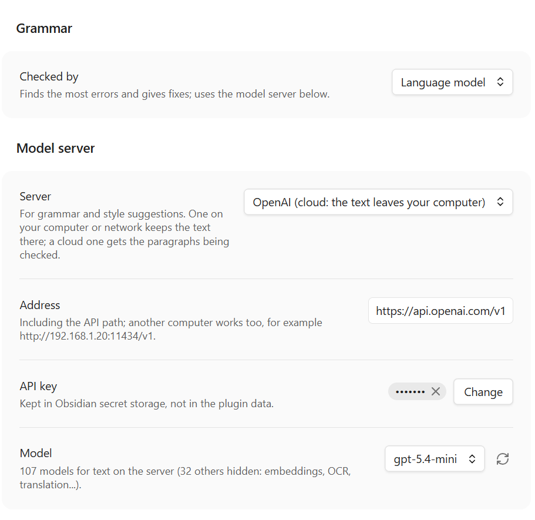
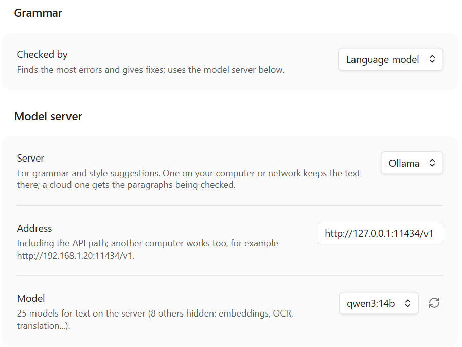

# BlueProof

Spelling and grammar checking for Obsidian by a language model, on your own computer or in the cloud (OpenAI, Anthropic, Google Gemini). It catches the errors
rule-based checkers miss, as you write. Desktop only.


## Features

- **Finds more.** A language model reads the whole sentence, and the one before it: "Mary opened the book. Then he wrote
  the answer." On our test sentences models found far more errors than LanguageTool.
- **Underlines as you write**: red for spelling, blue for grammar. Click one for the fixes.
- **Spelling** with Windows' own checker or Hunspell dictionaries, plus your own word lists kept as notes.
- **Many languages**, a different one in each paragraph.
- **Never slows your typing**: checks run after a pause, only on what changed.
- **Leaves code, links and math alone**, LaTeX formulas included, while the sentence around them is still checked.
- **Style suggestions** on a command; nothing in your note changes until you pick a fix.

A spelling checker sees one word; the model reads the sentence. Here the dictionary offers *don't*, and the model,
seeing *She*, gives *doesn't* and says why:


## Installation

BlueProof is not in Obsidian's community plugin list yet. Until it is:

1. Download `main.js`, `manifest.json` and `styles.css` from the [latest release](../../releases/latest).
2. Put them into `<your vault>/.obsidian/plugins/blueproof/`.
3. In Obsidian: **Settings → Community plugins**, turn on **BlueProof**.

Or with [BRAT](https://github.com/TfTHacker/obsidian42-brat): add this repository's address, and BRAT keeps the plugin
up to date.

## Setup

**Spelling** works at once on Windows (Windows' own spell checker), in the languages installed in Windows: a note in
American English needs English (United States) there, not only English (United Kingdom); **Settings → BlueProof → Spelling** lists the ones Windows has. On Linux and macOS, download a
dictionary for your language in **Settings → BlueProof → Spelling → Manage…** (the system's Hunspell dictionaries count
too). (Not tested on macOS yet.) A language with no dictionary gets ⚠ in the status bar.

While BlueProof checks spelling, Obsidian's own spellcheck (**Settings → Editor → Spellcheck**) is kept out of the
note's text, so a word is not underlined twice. That setting is not changed: turn BlueProof's spelling, checking while
typing or the plugin off, or mark a note `blueproof: off`, and Obsidian's is back; in a note with a language BlueProof
has no dictionary for (⚠), Obsidian's checks it meanwhile. It still checks the note's title and properties.

**Grammar** needs a language model. Choose where it runs:

- **OpenAI**, **Anthropic (Claude)** or **Google Gemini**: works on any computer; paid per use (Gemini has a free tier
  with a daily limit); the paragraphs being checked go to that company. How the cloud models compare: [docs/servers.md](docs/servers.md).
- **A model on your own computer**: free and private; needs a graphics card with about 8–12 GB of memory.

### OpenAI

1. Create an API key at [platform.openai.com/api-keys](https://platform.openai.com/api-keys).
2. **Settings → BlueProof → Model server**: choose **OpenAI**, paste the key, pick a model (`gpt-5.4-mini`: as accurate
   as the best and the fastest in our tests).
3. Press **Check** at the top of the settings.



### Anthropic (Claude)

1. Create an API key in the [Claude Console](https://console.anthropic.com/settings/keys).
2. **Settings → BlueProof → Model server**: choose **Anthropic Claude**, paste the key, pick a model:
   `claude-sonnet-5-5` found the most in our tests, `claude-haiku-5-5` made no false finding and is quicker.
3. Press **Check** at the top of the settings.

### Google Gemini

1. Create an API key in [Google AI Studio](https://aistudio.google.com/apikey) (free, with daily limits; far higher
   ones with billing set up).
2. **Settings → BlueProof → Model server**: choose **Google Gemini**, paste the key, pick a model (measured 2026-10-11;
   Google's models change): `gemini-3.8-flash` found the most of all the cloud models in our tests, slower on long
   paragraphs; `gemini-3.5-flash-lite` is the fastest and cheapest, and the one a free key allows most of (500 requests
   a day, the Flash models 20). Pro and Gemma are not worth it: [docs/servers.md](docs/servers.md). On the free tier
   Google may use what is sent to improve its products; with billing set up it does not.
3. Press **Check** at the top of the settings.

### Ollama

1. Install [Ollama](https://ollama.com) and run `ollama pull qwen3:14b`.
2. **Model server**: choose **Ollama**, pick `qwen3:14b` from the list.
3. Press **Check**.



### llama.cpp

1. Download [llama.cpp](https://github.com/ggml-org/llama.cpp/releases) for your system and a model file (`.gguf`,
   e.g. Qwen3 14B `Q4_K_M`) from Hugging Face.
2. Start it: `llama-server -m Qwen_Qwen3-14B-Q4_K_M.gguf --port 8080 -ngl 99`
3. **Model server**: choose **llama.cpp**, press **Check**.

### LM Studio (not tested yet)

1. In [LM Studio](https://lmstudio.ai), download a model, load it and start the local server.
2. **Model server**: choose **LM Studio**, pick the model, press **Check**.

It should work like the others, but we have not tried it yet: treat it as experimental.

A server on another computer, and which model suits which language: [docs/servers.md](docs/servers.md).

The first check after a local model starts can take a minute while it loads.

## Using it


Underlined words appear a moment after you stop typing. Click one to see what is wrong and pick a fix, ignore it, or add
the word to your dictionary.

The status bar shows how many findings the note has (click to go to the next one) and the note's language (click to
change it).


**Languages.** List yours in the settings (`en-GB, ru-RU`) or leave **auto**. A note can name its own in its
properties (`language: de`). British and American English cannot be told apart from the text, so set the one you use.

**Commands** (no default hotkeys; give them yours in Settings → Hotkeys): check the paragraph at the cursor, go to the
next or previous finding, suggest a better wording, turn checking off for a note, find unknown words in your vault.

More: [docs/usage.md](docs/usage.md).

## Your own dictionaries

Names and terms the spelling dictionary does not know are kept in ordinary notes in a folder, `Dictionaries` by
default. **Add to dictionary** in the popup writes to `Dictionaries/Personal.md`; you can add any number of notes by
subject and switch each on or off in the settings.

A dictionary note looks like this:

```markdown
---
language: en
---
# Mathematics: words my spelling dictionary does not know
Euler* Lagrange* Cauchy
eigenvalue eigenvector
- isomorphism
```

- One word per line or several separated by spaces; a list (`- word`) works too.
- `Euler*` stands for the word and up to four more letters: Euler's, Eulerian.
- Lines starting with `#` are comments. Letter case does not matter.
- `language` in the properties says which language the words count for; without it they count in every language.

**Find unknown words in my notes** (a command) lists the unknown words of your vault, most
frequent first, so you can add the right ones in one go. Examples to start from:
[docs/dictionaries](docs/dictionaries).

## Why BlueProof

- **It reads for meaning.** Rule-based checkers catch typos and common slips but miss errors that need the sentence
  understood. The model is also asked to check each sentence against the ones before it: pronouns, gender, number,
  tenses.
- **Formulas stay out of the way.** A LaTeX formula in the middle of a sentence usually confuses a checker. BlueProof
  keeps formulas out of the check and still checks the sentence around them.
- **Fewer false alarms.** A fix that rewrites the sentence, translates a word or changes a number is thrown away.
- **Long paragraphs are cut at sentence ends**, each piece with the sentence before it for context: as many errors found
  as sending the whole paragraph, two to four times sooner.

## Privacy

- The paragraph being checked goes to the server you chose and nowhere else: your own computer, or OpenAI, Anthropic
  or Google if you chose one of them.
- No account, no telemetry, no ads. An API key is kept in Obsidian's secret storage and sent
  only to the server it was given for.
- Hunspell dictionaries are downloaded from LibreOffice's repository on GitHub (`api.github.com`,
  `raw.githubusercontent.com`) only when you ask, into the plugin's folder; none of your text is sent. On Linux and
  macOS the system's dictionaries, outside the vault, are read too (`/usr/share/hunspell`, `/usr/share/myspell`,
  `~/Library/Spelling`, `/Library/Spelling`); nothing is written there.
- On Windows, spelling goes through a PowerShell process the plugin starts; it gets single words, nothing leaves the
  computer.
- The language of each paragraph is found inside the plugin, by fastText's language model built into it (about 1 MB,
  part of `main.js`); nothing is downloaded or sent for it.
- The plugin never installs or starts servers; you run them.

## Licence

MIT. Bundled: [nspell](https://github.com/wooorm/nspell) with its dependencies (MIT);
[fastText](https://github.com/facebookresearch/fastText) (MIT) compiled to WebAssembly by
[fasttext.wasm.js](https://github.com/yunsii/fasttext.wasm.js) (MIT), with fastText's language identification model
[lid.176.ftz](https://fasttext.cc/docs/en/language-identification.html) by Facebook, under
[CC BY-SA 3.0](https://creativecommons.org/licenses/by-sa/3.0/), unchanged. The
Hunspell dictionaries are not bundled: they are downloaded on request from LibreOffice's repository, each under its own
licence (shown in the Hunspell window).
